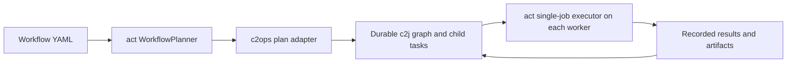
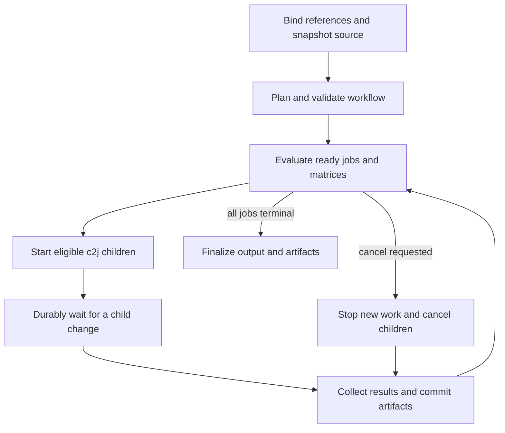

# Run GitHub Actions jobs with c2j orchestration and act execution

Status (2026-10-30): the initial `gha` `backend: c2j` is implemented and tested
through real c2j workers and embedded JobDB. Use the executable contracts in
[gha](gha/README.md), [orchestration](gha/workflow/README.md),
[executor](gha/job/README.md), and [harness](gha/integration/README.md).
The design sections below retain the broader roadmap; proposed examples are
not substitutes for those current interfaces.

Implemented: independent child DAGs and durable waits; static/dependency-driven
matrix expansion; explicit runner-profile execution needs; dispatch/push/PR
trigger filtering; named secret resolution at each executor; Git snapshot
transfer for unpublished commits; private v4 artifact upload/download with
JobDB publication/hydration; final result collection; deterministic submission
IDs; the asynchronous public submit-then-await interface. The existing single
CI workflow tests and builds both Linux architectures, including real pinned
v4 artifact actions, and publishes all three compiled GHA binaries.

Initial compatibility boundaries: `fail-fast: false` is required for matrices;
`max-parallel`, distributed sibling cancellation, job timeouts and job-level
continue-on-error remain unsupported. Reusable workflows, job/service/Docker
actions, Actions caches, GitHub permissions/OIDC and protected environments are
rejected or unavailable. `gha-many` retains its existing backends; callers can
submit several `gha` steps from c2j. The upstream act host-runner race remains a
production-qualification limitation. VM/nested-VM provisioning is separate
execution-provider work, not implemented by an extension op.

Agreed scope: populate workflow metadata from c2j and pass named credentials
through c2j secrets. GitHub OIDC is explicitly unsupported for this implementation.
Extend the generic execution contract to select VM isolation and, when needed,
hardware-accelerated nested virtualization. Section 5.3 proposes the names and
matching semantics; those fields are not implemented in the inspected c2j version.
Callers can explicitly select push-style or PR-style evaluation without creating
a GitHub pull request. Section 7.1 defines the event/branch contract separately
from the source revision actually tested.

## 1. Decision and scope

Correction from the CLI/broker audit (2026-10-30): c2j already supports repeated
`c2j submit` calls from extensions, including local recipe snapshots, formal
child relationships, and recorded `jobs` context. Native recipe operations
provide durable starts/waits and reference forwarding. The earlier composition
request incorrectly treated these as blocked. See the corrected
[capability audit](FEATURE_REQUEST_C2J_COMPOSED_WORKFLOW_OPS.md).

For a static DAG, submit wrappers asynchronously and put prerequisite waits in
each dependent wrapper. C can run after A without waiting for unrelated B; a
central wait-any API is not a prerequisite. Use native deterministic child
starts for replay. A CLI-based submission boundary needs explicit reconciliation
after an ambiguous response because repeated CLI submits create fresh IDs.

Use c2j's workflow primitives to own workflow lifetime, dependencies, parallel
children, execution requirements, durable results, and artifacts. Use the
exported Go APIs in `act` to execute **one selected job instance** on the worker
assigned by c2j. A matrix combination is a separate job instance.

The target is an ordinary workflow with an ARM build, an AMD64 build, and a third
job that consumes both results. The workflow author should continue writing
`runs-on`, `needs`, expressions, and standard artifact actions. The recipe author
binds that workflow to c2j execution profiles, secrets, configuration, and input
artifacts.

Execution needs supplies most of the **placement contract**: platform, image,
CPU, memory, storage, and declared tools. We should reuse it rather than create
another scheduler. It does not turn a process into a schedulable graph, provision
workers on its own, translate GitHub expressions, transport files, or reproduce
GitHub's identity and service APIs. Those are the bridges this plan defines.

Initial supported execution targets are native Linux ARM64 and AMD64, matching
our published Nix packages. Other OSes require corresponding workers, packages,
and compatibility tests; recognizing an execution platform string is insufficient.

## 2. Baseline verified in this repository

The original planning baseline used `act v0.2.89` and c2j
`v0.0.76-0.20261015024712-66010fb85af6` from the earlier Codex integration module.
The new GHA harness pins c2j `v0.0.110` and JobDB `v0.0.65`; section 12 records
the implementation audit and remaining gaps against those versions. Recheck
upstream contracts as each later milestone begins.

| Existing behavior | Consequence for this work |
| --- | --- |
| `gha` is one process receiving JSON and returning an output envelope. | Its subprocess can submit children through the existing invocation broker, including via `c2j submit`; an output envelope alone does not schedule jobs. |
| The local backend calls `Runner.NewPlanExecutor` on the complete plan. | All jobs remain inside one task and one configured Docker execution environment. |
| `gha-many` uses goroutines to run complete workflows. | Those goroutines do not become independently placed c2j children. |
| The current `secrets` map has secret-marked string values. | Named credentials already work for one invocation; forwarding them through orchestration requires preserving references. |
| c2j has sequences, state machines, `child_group`, catches, retry metadata, object checkpoints, and node execution needs. | Reuse these mechanisms for durable orchestration and transfer. |
| `RunContext.Executor()` is exported; a manually constructed `model.Plan` can contain one run. | An executor adapter can use upstream Go APIs without initially forking act. |
| `PlanJob(id)` includes prerequisite jobs. | It is not an API for executing only one externally scheduled job. |
| `WorkflowPlanner` returns public `Plan`, `Stage`, and `Run` structures; each run retains its workflow/job model. | Reuse upstream parsing/planning and translate the job's `Needs()` edges into the durable c2j graph. |
| `PlanEvent(name)` selects by event name, without evaluating branch/path/activity filters. | Event selection alone is insufficient; the adapter must evaluate supported trigger filters. |
| act's `needs` context reads dependency jobs' `Outputs` and `Result` from the workflow model. | We can populate these fields from durable c2j results before executing a downstream job. |

Sources: [current local backend](gha/pkg/gha/act_backend.go),
[batch orchestration](gha/pkg/gha/op.go), [extension contract](EXTENSION_OPS.md),
[secret/config contract](https://github.com/colony-2/c2j/blob/66010fb85af6/SECRETS_AND_CONFIG.md),
[object contract](GUIDE-Op-Object-Checkpoints.md), and upstream
[runner](https://github.com/nektos/act/blob/v0.2.89/pkg/runner/runner.go),
[RunContext](https://github.com/nektos/act/blob/v0.2.89/pkg/runner/run_context.go),
[planner](https://github.com/nektos/act/blob/v0.2.89/pkg/model/planner.go), and
[expression evaluator](https://github.com/nektos/act/blob/v0.2.89/pkg/runner/expression.go).

The current implementation also needs these focused audits before it becomes the
basis of the new backend:

- It configures an artifact-server address/path, but the local backend does not
  call `artifacts.Serve`. Upstream starts that server separately. Configuration
  fields alone do not establish a working upload/download service.
- Current job result keys are based on display names in parts of normalization;
  distinct matrix instances or jobs with the same name need collision-free IDs.
- The GitHub backend maps skipped/neutral conclusions to a successful normalized
  status. Preserve the original conclusion when reconstructing `needs.result`.
- Job logs are captured through act hooks. Explicitly connect live diagnostics
  to stderr and durable log artifacts; do not assume the logger configuration
  automatically does both.

## 3. Ownership and the public entry point

### 3.1 Split orchestration from execution

| Layer | Owns | Does not own |
| --- | --- | --- |
| c2j wrapper recipe/composite | Child start/wait/cancel, durable transitions, reference forwarding, execution needs, result collection | Running action steps or interpreting GHA expressions as CEL |
| c2ops planner/reducer helpers | GHA parsing, supported-feature validation, matrix/condition evaluation, ready-job decisions, normalized result assembly | JobDB credentials, background scheduler loops, secret lookup |
| c2ops single-job executor | act initialization, one job instance, step lifecycle, outputs, diagnostics, artifact protocol adapter | Rerunning dependencies or dispatching another architecture internally |
| Existing provisioner/runtime | Matching demand with actual allocations, workspace setup, worker lifecycle | Inferring GHA semantics from an opaque subprocess |

Proposed helper package attributes are `gha-plan`, `gha-advance`, `gha-job`, and
`gha-finalize`. They can share a Go module and executable implementation. Their
names describe contracts, not a requirement to create four separate services.
Publish compiled binaries and manifests for both supported Linux architectures,
using the existing workflow and Cachix cache. Workers require no Go compiler.

### 3.2 Preserve the one-call experience through composition

The desired call remains:

```yaml
# Design sketch; see gha/README.md for the implemented submit/await interface.
op: nix:github:colony-2/c2ops/published#gha
inputs:
  backend: c2j
  workflow: .github/workflows/build.yml
  with:
    release_channel: '${{ context.config.release_channel }}'
  vars:
    CACHE_NAME: '${{ context.config.cachix_cache }}'
  secrets:
    CACHIX_AUTH_TOKEN: '${{ context.secrets.cachix_colony2_token }}'
    GITHUB_TOKEN: '${{ context.secrets.?github_token.orValue(null) }}'
```

An extension can submit wrapper recipes through the existing child broker and
return their identities; the caller can then await their results with native
recipe operations. That route requires no new c2j composition feature. A
synchronous one-selector interface is a separate convenience. Keep resolved
secret values out of generated recipes: plan from public metadata and binding
names, or forward references through native recipe inputs. Do not start a nested
c2j engine or substitute direct JobDB credentials for the scoped broker.

Preferred delivery:

1. Implement a reusable c2j wrapper recipe using the existing primitives and
   separately callable helper ops. Ship and test this explicit recipe first.
2. Use the existing local-recipe submission/broker contract when an extension
   needs to submit a generated wrapper. Await its recorded child identity in
   recipe logic. Keep the existing local and GitHub backends available.
3. Consider a packaged recipe-backed selector later if it improves the call
   interface. This is optional upstream convenience, not a workflow blocker.

The composition contract should identify a trusted, immutable recipe, its input
schema, helper selectors, and result projection. It must preserve opaque secret
references and object references, caller cancellation, artifact visibility, and
execution scope. An ordinary op output containing YAML or a `children` field
must remain ordinary data, not implicitly become executable code.

If the wrapper needs a generated recipe with per-secret scalar declarations,
generate it in trusted adapter code and submit its snapshot through the existing
broker. Workflow steps and build artifacts must not supply arbitrary wrapper
recipe text. Secret values must never be embedded in that snapshot.

### 3.3 Reuse act's planner through an adapter

The existing public boundary is useful, but it is not a scheduler-provider hook.
In the pinned act version, `model.WorkflowPlanner` exposes `PlanEvent`, `PlanJob`,
`PlanAll`, and `GetEvents`. Its `Plan` contains sequential `Stage` values, each
containing parallel `Run` values. `Run.Job().Needs()` exposes the original
dependency IDs. The separate `runner.Runner` interface exposes only
`NewPlanExecutor(*model.Plan) common.Executor`; its implementation constructs
local execution pipelines internally. There is no configuration callback for
replacing each scheduled job with a remote c2j submission.

Use the following composition:



The adapter consumes the upstream plan as data. It deduplicates runs by workflow
identity and job ID, reads each job's actual `needs` edges, and records those in
`WorkflowPlan/v1`. Reuse act's expression and matrix facilities where their
semantics fit, behind the version-pinned adapter. We do not need to replace the
YAML parser or fork act to prove this approach.

Do not convert every act stage into a c2j wait-all barrier. For example, if `a`
and `b` are independent and `c` needs only `a`, finishing `a` should make `c`
eligible even while `b` runs. Stage order is useful for inspecting the static
plan; original dependency edges determine c2j readiness.

The plan is not a fully evaluated execution graph. Trigger filters, job
conditions, dependency-driven matrices, runner profiles, and failure/cancellation
semantics still require the reducer and context bridges below. In particular,
`PlanEvent("pull_request")` alone does not enforce `branches`, `paths`, or `types`.
Evaluate the trigger gate before scheduling children, and evaluate later
conditions/matrices as their required dependency results become available.

Implementing our own Go `runner.Runner` is technically possible, but its
process-oriented executor return type does not itself provide durable c2j
submission/wait/replay. Prefer an explicit plan-to-recipe adapter and the generic
composition boundary in section 3.2. Do not invoke act's whole-plan executor on
the controller and attempt to intercept its goroutines.

Verified against the public [planner/model API](https://github.com/nektos/act/blob/v0.2.89/pkg/model/planner.go)
and [runner implementation](https://github.com/nektos/act/blob/v0.2.89/pkg/runner/runner.go).

## 4. Workflow graph and transitions

### 4.1 Durable records

Define versioned JSON contracts, with schemas and example fixtures:

| Record | Required information |
| --- | --- |
| `WorkflowPlan/v1` | Source/workflow digests; normalized event snapshot/digest, simulation provenance, and trigger decision; typed inputs; logical jobs and edges; retained GHA expressions; runner-profile mapping; action references; compatibility policy and adapter version |
| `WorkflowState/v1` | Run identity; logical-job and instance states; accepted result refs; child IDs; scheduler decisions; cancellation state; artifact catalog revision |
| `JobInvocation/v1` | Plan ref; logical job ID; canonical matrix assignment; instance/attempt IDs; selected execution profile; source snapshot ref; dependency results; artifact catalog view |
| `JobResult/v1` | Instance/attempt IDs; raw and effective conclusions; step summaries; exported string outputs; artifact refs; diagnostics; execution provenance |

Use immutable c2j objects for large plans, workflow state snapshots, and detailed
job results. Use ordinary output fields for small routing values such as
`done`, `has_ready`, result counts, and terminal conclusions. Object references
are opaque to recipe routing, so a helper must return those routing values
explicitly. Object storage is not a place to hide plaintext secrets.

A job instance ID is derived from the workflow invocation identity, logical job
ID, and canonical typed matrix assignment. Attempts have separate identities.
Do not derive identity from display names, goroutine order, or current time.
Reuse c2j's stable child-submission identity to make scheduling replay-safe.

### 4.2 Parent state machine



The controller runs as short durable tasks separated by c2j waits. It must not
hold a worker in a process-local polling loop while builds run elsewhere.

For the motivating workflow, ready children `arm` and `amd` start independently.
When both are terminal, the reducer evaluates `combine` using their results.
With the default success condition, both must have succeeded. An explicit
`always()` or another supported status condition can instead make a reporting
job eligible after failure. [GHA dependency and condition semantics](https://docs.github.com/en/actions/reference/workflows-and-actions/workflow-syntax#jobsjob_idneeds)

### 4.3 Job-instance state transitions

| State/event | Required transition |
| --- | --- |
| Unresolved dependencies | Keep blocked; do not allocate a runner or resolve job secrets. |
| Dependencies terminal | Evaluate job condition in GHA semantics, then expand any eligible matrix. |
| Condition false | Record `skipped` without launching a worker; this is a real dependency result. |
| Ready with capacity | Start/recover the stable child identity; publish its execution demand. |
| Allocation mismatch | Yield for a matching worker; do not mark the GHA job failed or executed. |
| Execution begins | Record attempt identity; hydrate source/artifacts and resolve allowed secrets. |
| Steps finish | Publish outputs/logs/artifacts, then accept the result as terminal. |
| Worker/system failure | Use explicit retry/recovery policy; retain failure provenance and fence stale attempts. |
| Workflow cancellation | Stop scheduling ordinary work, propagate cancellation, and collect terminal results. |

Do not treat a metadata handoff as a new workflow run or a retry of already
completed work. Replayed results must not request their old architecture, resolve
their old secrets, or execute actions again.

### 4.4 How existing primitives fit

- Use sequences for plan/setup and finalization.
- Use a state machine for repeated advance/start/collect decisions.
- Use `child_group` or the underlying durable child-start operations for fan-out.
- Put concrete `execution_needs` on each child's executor node or recipe. The
  parent's ARM/AMD settings must not become hard job-level overrides for every
  child; explicit c2j job overrides can supersede node requirements.
- Use catch/result collection to turn failed child execution into a dependency
  result, so failure-reporting jobs remain schedulable.

Use start-only child operations and put durable waits inside dependent wrappers.
That permits incremental progress without a wait-any controller. Existing
`recipe.await_result_soft` makes terminal failures collectable. Audit cancellation
separately for fail-fast; do not treat it as a prerequisite for ordinary DAGs.

A barrier-per-ready-batch prototype can prove the ARM/AMD/combine case. It is an
explicit prototype restriction: in a larger graph, a child must be able to start
as soon as its own dependencies finish, without waiting for unrelated jobs in
the same batch. Do not claim full DAG scheduling until that test passes.

## 5. Placement and runner environments

### 5.1 Translate runner labels through explicit profiles

`runs-on` is a GitHub label expression; it is not directly an OCI platform.
Evaluate it after the required inputs, dependency outputs, and matrix values
exist, then match a declared profile. Unknown or ambiguous mappings are errors.
Do not silently skip an unsupported platform, as act can do for an unmapped label.

Illustrative profile configuration:

```yaml
# Proposed profile schema. Image names are placeholders, not published images.
runner_profiles:
  ubuntu-24.04-arm:
    execution_needs:
      platform: linux/arm64
      image: registry.example/gha-worker:ubuntu24
      resources: {cpu: '4', memory: 8Gi}
    act:
      mode: worker
  ubuntu-24.04:
    execution_needs:
      platform: linux/amd64
      image: registry.example/gha-worker:ubuntu24
      resources: {cpu: '4', memory: 8Gi}
    act:
      mode: worker
```

Match label arrays as a set of requirements, not by choosing their first member.
Runner groups/custom labels require explicit mappings. Record the chosen profile
and image identity in the plan/instance result. Resolve mutable image tags for
the run where supported, and retain both requested reference and actual digest.
Check conflicts with caller constraints before doing work; never resolve an
ARM request by executing it as AMD64 without an explicit emulation policy.

### 5.2 Prefer the c2j worker as the job environment where possible

There are two different images to avoid conflating:

1. The c2j execution image: runs the packaged executor and supplies its tools.
2. An optional act job container: the environment where steps execute when using
   container mode or `jobs.<id>.container`.

For shell, JavaScript, and composite actions, prototype act's `-self-hosted`
platform mapping on a fresh, isolated c2j job worker. This refers to act's host
execution mode, not registration of a GitHub self-hosted runner. It avoids
putting an unnecessary second runner container inside the c2j environment.
Validate Node runtime provisioning and cleanup in this mode before making it
the default. [act runner modes](https://nektosact.com/usage/runners.html)

Retain an explicit container mode where needed. Docker actions, service
containers, and workflow `container:` declarations need a reachable Docker
engine, compatible networking, mounts, and permissions. Tools installed through
Nix on the outer worker do not automatically appear in an inner job container.
The selected profile must supply the correct environment in both cases.

Execution needs does not currently describe arbitrary capabilities such as a
Docker daemon, privileged mounts, GPU devices, or network policy. An image alone
does not guarantee them. The planned VM/capability extension below addresses
Docker and nested guests through the same execution-needs mechanism. Until that
contract is implemented, use verified provisioner profiles; do not submit the
proposed fields to existing workers or fall back to an unsuitable environment.

### 5.3 Proposed VM isolation and capabilities contract

Keep the execution boundary separate from facilities available inside it.
Recommend two new top-level fields in `execution_needs`:

```yaml
# Proposed generic c2j fields, not current syntax.
execution_needs:
  platform: linux/amd64
  isolation: vm
  capabilities: [docker, nested_virtualization]
  resources:
    cpu: '8'
    memory: 16Gi
    ephemeral-storage: 100Gi
```

`isolation` selects the boundary; `capabilities` is a set of positive requirements.
Avoid a combined enum such as `vm-with-docker-and-nested-vms`: the two capabilities
can be needed independently. Proposed initial values are:

| Field/value | Required behavior |
| --- | --- |
| `isolation: container` | At least the existing isolated task-container boundary. A task-scoped VM is also an acceptable allocation when it supplies the same task environment; this request does not promise a task-owned guest kernel or require a particular packaging mechanism. |
| `isolation: vm` | A fresh or equivalently reset, task-scoped VM boundary with its own guest kernel. The worker may execute directly in the guest or in a container inside that task's VM. A shared VM containing many unrelated task containers does not satisfy this request. |
| `capabilities: [docker]` | A usable, job-scoped Docker Engine API supporting the adapter's build/run/network/volume requirements, reachable from the actual job context. A Docker CLI alone is insufficient. The engine and its containers must respect the allocation's isolation and resource contract. |
| `capabilities: [nested_virtualization]` | The task can launch hardware-accelerated guests inside its allocated VM, with usable virtualization devices and permissions from the actual job context. This initially promises one additional guest level, not arbitrary recursive nesting. |

Examples of demand, rather than separate backend implementations:

| Workload | Isolation | Capabilities |
| --- | --- | --- |
| Ordinary shell/Node build | Existing container default | None |
| `docker build`, Docker actions, or service containers on a VM | `vm` | `docker` |
| QEMU/KVM guest tests inside a VM | `vm` | `nested_virtualization` |
| A Docker-based test harness that starts accelerated guests | `vm` | Both |

Docker workloads do not inherently need nested hardware virtualization. The
`docker` capability supplies a functioning container engine; the nested capability
is for launching accelerated VMs from a VM. On Linux/KVM this requires suitable
host/guest configuration and working device access, not just a QEMU executable
or a visible CPU flag. Providers must qualify each platform independently; an
AMD64 result is not evidence of ARM64 support. [KVM nested-guest model](https://docs.kernel.org/virt/kvm/x86/running-nested-guests.html)

Matching and scope rules:

- Omitted isolation keeps existing placement behavior; it does not request a VM.
  An explicit VM requirement must never silently degrade to a shared container.
- `nested_virtualization` requires an effective `isolation: vm` in this initial
  contract. Other hardware-virtualization arrangements can get a separate
  capability later instead of overloading the meaning of nesting.
- Omitted/empty capabilities mean no additional requirement. Normalize names,
  deduplicate, and reject unknown values. Use registered capability names rather
  than arbitrary labels that workers can interpret inconsistently.
- Capabilities accumulate within inherited scopes; an inner node can add a need,
  and leaving that scope restores the parent's set. An empty list does not clear
  inherited requirements. A sibling has its own effective demand. Reject
  contradictory effective requests, including nested virtualization without an
  effective explicit VM request, rather than dropping a capability.
- Isolation selection follows the existing requirement-overlay precedence;
  capabilities combine by set union. Apply compatibility validation after all
  recipe/node and explicit job overrides are combined. The coordinator must not
  impose a container override on a child that is meant to request a VM.
- The trusted provisioner reports actual isolation and **verified available**
  capabilities in the allocation. Matching requires every requested capability;
  unknown allocation facts cannot satisfy an explicit requirement. An image tag,
  requested demand, or installed binary is not proof of availability.
- Preserve the current successful-task/replay boundary: a new need yields before
  unfinished execution; completed tasks do not need their old VM recreated.
- Distinguish an unsupported request from supported capacity that is temporarily
  unavailable. Neither should result in a worker repeatedly accepting and yielding
  the same incompatible lease.

Keep `image`'s existing meaning as the task's software environment. Do not
silently reinterpret an OCI reference as a VM disk image. A provisioner can boot
a compatible guest and run that task image inside it. VM boot image, kernel, and
hypervisor selection belong to provisioner profiles initially; tests requiring
a particular guest kernel will need an explicit additional contract. Report the
actual boundary and task image separately in allocation provenance.

Resource minima describe capacity usable by the task and its subordinate
containers/VMs together, after provisioning overhead. They are not a promise of
the same memory/CPU separately for every nested guest. Storage must account for
build layers and guest disks. Worker teardown must terminate guest VMs and
containers even if the executor crashes; c2j checkpoints do not preserve a live
hypervisor or arbitrary VM RAM across handoff.

The provisioner configures the engine, virtualization exposure, permissions,
mounts, and networking before reporting the capability ready. Do not try to
enable nesting by calling `modprobe` on an unqualified shared worker from an
ordinary workflow step. A task container inside its own VM must actually receive
the required engine/device access; the outer VM being capable is not enough.

This is generic c2j/provisioner work, not a GHA-specific backend. Implementation
must update requirement/allocation schemas, validation, overlays, template
resolution, demand digests and snapshots, task guards, handoff, CLI/API handling,
and provisioner admission. Version the changed contracts so older consumers
reject unsupported demands rather than ignore their fields.

Qualification tests must include an ordinary VM job, a real Docker build/run,
service networking and cleanup, and a small nested guest boot using an explicitly
hardware-accelerated mode with software-emulation fallback disabled. Also test
missing/denied device access, per-platform capability mismatch, resource pressure,
worker cancellation, and teardown of orphaned child VMs/containers. Test these in
the final task context, including the container-in-VM arrangement if used.

### 5.4 Cross-platform package resolution is a release gate

Our extension guide currently warns that Nix metadata inspection and execution
need compatible platforms. Confirm the current implementation's behavior with
node-level handoff: an AMD64 controller must not pin an AMD64 store path and pass
it as the executor for an ARM child.

Resolve the published helper selector once to an immutable flake revision, then
select/evaluate the target-system output after the child's target is known, or
perform inspection on a compatible worker. Record the per-system store path and
manifest. Public recipes can continue using `published`; internal recording of
resolved revisions is necessary for replay and is not a demand that users write
commit coordinates. Both closures must already exist in Cachix.

## 6. Secret, config, and input bridges

### 6.1 Named secrets: c2j to GHA

The recipe author's key is the GHA secret name; the value is a c2j reference:

```yaml
secrets:
  CACHIX_AUTH_TOKEN: '${{ context.secrets.cachix_colony2_token }}'
```

The workflow continues using ordinary GHA syntax:

```yaml
- name: Publish cached builds
  env:
    CACHIX_AUTH_TOKEN: '${{ secrets.CACHIX_AUTH_TOKEN }}'
  run: ./scripts/publish-to-cachix.sh
```

The repository script is illustrative. The same binding can be used in an
existing action's `with:` inputs, including the Cachix action we already use.

The end-to-end transition is:

```text
c2j secret reference
  -> reference retained by wrapper/child inputs
  -> c2j resolves it on the executing child's live task
  -> gha-job receives the string on stdin
  -> runner.Config.Secrets["CACHIX_AUTH_TOKEN"]
  -> GHA expression evaluation inside the selected job
```

Only the final worker receives values. The planner/reducer receives public
secret binding names, if needed, and never receives values. It must not take a
secret map into a normal extension call and then return that map in its plan:
normal extensions receive already materialized input, and their output is
durable public data.

The single-job manifest declares:

```yaml
secrets:
  type: object
  additionalProperties:
    type: string
    x-secret: true
```

The wrapper must preserve these string-leaf annotations through composition.
The inspected c2j recipe input schema supports scalar secret inputs but does not
support arbitrary nested secret maps as ordinary recipe `type: object` inputs;
that type denotes checkpoint objects. Two valid implementation routes are:

- Generate explicit scalar secret inputs for the known binding names and
  assemble the named map only at the executor call, keeping references opaque.
- Add generic schema-aware forwarding for named secret maps to recipe/composite
  inputs, reusing the extension schema's semantics.

Start with the first route for a fixed wrapper prototype. A public map of binding
names can also be compiled into executor-only secret
references using the existing local-recipe submission contract. A map of already
materialized values must not be written into the generated recipe. Do not serialize
opaque references into strings, materialize them in a planner,
or hand-construct c2j's private reference wire format to bypass validation.

Default exposure can match GHA's workflow-level secret map; offer explicit
per-job subsets for narrower access. Static scanning cannot reliably determine
all secrets a composite action or dynamically indexed expression might use.
Validate names and case-collision rules. Optional c2j references may omit a
binding; required bindings should fail before action execution. An omitted
binding must have the documented GHA missing-secret behavior, not a literal
reference string.

### 6.2 Credentials are capabilities, not just strings

`GITHUB_TOKEN` is a supplied credential, not an automatically minted GitHub
installation token. `permissions:` cannot reduce a PAT's actual privileges.
For this implementation, use pre-scoped credentials supplied as named c2j
secrets and populate the expected `secrets.GITHUB_TOKEN`/`github.token` contexts.
Document the credential's actual scope; do not claim permission enforcement just
because act accepts the YAML. A GitHub App token issuer can be added separately
later. Repository, commit, branch, actor, and local run metadata come from the
recorded c2j context as described in section 7.1.

**GitHub OIDC is explicitly unsupported.** Reject `id-token: write` requests
during preflight with a specific unsupported-feature error. Do not advertise an
OIDC endpoint or manufacture GitHub-signed identity. If an action attempts OIDC
without a detectable declaration, return a clear unsupported-operation error.
Workflows needing cloud access must use bound credentials or an already supported
non-OIDC authentication method. OIDC is not a prerequisite for shipping this
backend. Protected GitHub environments/approvals also remain outside initial
support.

Worker artifact-service tokens are separate from GitHub credentials. Never
expose c2j/JobDB service credentials to workflow steps. The artifact adapter gets
only the authority needed for the current run/attempt.

Secret plaintext must not enter plans, workflow snapshots, outputs, job-output
maps, or command lines. Redact captured/live logs using both the supplied secret
set and act's masking commands. Log masking is not an artifact-content scanner:
actions that write credentials to files can still leak them through artifacts.
Use focused tests for credential-bearing logs and outputs, and keep artifact
access within the execution's existing tenant/run authorization.

### 6.3 Public config and typed inputs

| Caller value | GHA destination | Resolution and persistence |
| --- | --- | --- |
| `with` | `inputs` and event inputs | Validate against workflow input definitions; preserve booleans/numbers where the selected event supports them. |
| Proposed `vars` | `vars` | Resolve c2j config in a dedicated setup task; record the public snapshot used by this run. |
| `env` | Workflow-wide environment overlay | String values; define precedence and prevent overriding framework identity/runtime endpoints accidentally. |
| Proposed `event` | Trigger selection, `github` context, and event payload | Normalize once against source metadata; record public values and distinguish simulation from real GitHub identity. |
| `secrets` | `secrets` | Resolve only for the live executing child; never snapshot values in the plan. |

If public config controls matrices, profiles, or other routing, first materialize
it in a c2j task and return validated public data. Do not reference
`context.config` directly from recipe routing expressions. Record once and
forward the resulting snapshot so one run does not use changing config values
for different matrix instances. Child secrets follow c2j's existing execution
access/cache lifetime; do not promise cross-child secret-version freezing unless
the secret service supports it.

### 6.4 Keep the expression languages separate

Both systems use `${{ ... }}` syntax, but their namespaces and evaluators differ.
c2j evaluates the caller's input bindings. Workflow file bytes and action inputs
remain GHA data and are evaluated by act at the proper job/step boundary.

Never interpolate the workflow YAML through c2j wholesale. In particular,
`${{ secrets.NAME }}`, `${{ needs.build.outputs.x }}`, and literal shell text
must not be interpreted as c2j templates. Copy upstream strings as data; do not
recursively template job outputs after they have already been evaluated.

## 7. Source, execution context, and dependency results

### 7.1 Repository and event context

Freeze the exact source/worktree snapshot used for planning. Every job receives
an independent worktree based on that snapshot through c2j's workspace/object
mechanisms. A local path is not a transferable reference. Do not automatically
merge changes made by different GHA jobs; files cross jobs only through explicit
artifacts or another declared output.

Keep these identities separate: source repository, source commit/snapshot,
workflow file/ref, c2j parent and child IDs, GHA-compatible run identity, job
instance ID, and attempt. Derive stable run IDs where action protocols need a
numeric/string identifier. Record mappings; do not manufacture URLs implying
that a local run exists on github.com.

Construct `github`, `inputs`, `matrix`, `strategy`, `runner`, and `needs` contexts
consistently for every job. `runner.arch` must describe the executing allocation.
`GITHUB_RUN_ID` is shared across jobs; run attempt and internal task retry are
separate concepts. Default to `workflow_dispatch`; callers may explicitly select
`push` or `pull_request` evaluation. Do not infer a PR merely from a non-default
branch or a recipe's name.

#### Caller-selected event and branch metadata

Proposed invocation for running PR-only checks without an actual GitHub PR:

```yaml
# Proposed backend/composition contract, not currently implemented.
op: nix:github:colony-2/c2ops/published#gha
inputs:
  backend: c2j
  workflow: .github/workflows/ci.yml
  source:
    mode: prepared
  event:
    name: pull_request
    action: synchronize
    pull_request:
      head: {ref: feature/parser}
      base: {ref: main}
```

For push-style evaluation, use `event: {name: push, ref: refs/heads/main}`.
`event.name` chooses the context presented to the workflow, not a GitHub API
operation. These invocations create no PR, push, check suite, or GitHub run.
They belong to the proposed c2j backend; the existing GitHub backend dispatches
a real `workflow_dispatch` and must reject incompatible event overrides.

| Proposed input | Contract |
| --- | --- |
| `source.mode` | `prepared` uses the frozen c2j worktree; `remote` explicitly fetches and freezes a revision before planning. Default: `prepared`. |
| `source.ref` | Required in remote mode; a branch, tag, or commit resolved once in the recorded source repository. Reject in prepared mode rather than ignoring it. Changing event metadata alone never checks out another revision. |
| `event.name` | Initially `workflow_dispatch`, `push`, or `pull_request`; default `workflow_dispatch`. Reject other selected events until implemented. |
| `event.ref` | Full branch/tag ref for dispatch or push; default from a known source ref. Require an explicit value when the snapshot has no suitable ref. Reject for PR mode, whose execution ref is derived below. |
| `event.action` | PR activity type, exposed as `github.event.action`; default `synchronize`. Initially support `opened`, `reopened`, and `synchronize`; other activities need explicit compatibility work. Reject on dispatch/push. |
| `event.pull_request.head.ref` / `.base.ref` | Required short branch names for PR evaluation. These populate `github.head_ref`, `github.base_ref`, and the corresponding payload fields. Reject PR fields on other events. |
| `event.pull_request.number` | Optional real PR number supplied by the caller; normalize both payload `number` and `pull_request.number`. Omit when there is no PR; never invent a GitHub number or URL from a c2j ID. Supplying metadata does not verify a PR's existence. |
| `event.changed_files` | Optional complete repository-relative path list for trigger filtering. Omitted means unknown; an explicit empty list means known no changes. Preserve that distinction. |
| `event.payload` | Optional public supplemental webhook-shaped data, such as labels or actor metadata. Validate size/types; reject conflicting normalized identity fields instead of letting arbitrary JSON override source/event identity. |

These values may be bound from recipe inputs or c2j config. They are ordinary
public input data, never a place for API keys. `with` remains the dispatch-input
binding, validated against declared inputs; reject nonempty `with` for the
initial push/PR modes rather than inventing dispatch inputs for those events.

Normalize one immutable event record before planning. Derive all copies of
`github.event_name`, `github.ref`, `github.sha`, head/base refs, event payload,
and `GITHUB_*` identity variables from it. Materialize the same event JSON at
each worker's `GITHUB_EVENT_PATH`; the absolute path may differ across workers.
Protect those fields from contradictory `env` overrides. Use the repository's
actual recorded default branch for `repository.default_branch`, independently
of the selected event branch. Record caller overrides and simulation provenance
alongside the event so diagnostics explain exactly what each condition saw.

#### Workflow triggers versus job and step conditions

There are two gates. First, evaluate the workflow's `on` declaration against the
selected event, including supported activity/branch/tag/path filters. Then use
GHA expressions for job and step `if` conditions with the same normalized
context. `pull_request.branches` matches the **base** branch; a head-branch
condition uses `github.head_ref`. Preserve filter glob ordering/negation and
the conjunction of branch and path restrictions. [Trigger filter syntax](https://docs.github.com/en/actions/reference/workflows-and-actions/workflow-syntax)

For example, this workflow selects the relevant job without requiring a PR to
exist on GitHub:

```yaml
name: Event-specific checks
on:
  pull_request:
    branches: [main]
  push:
    branches: [main]
jobs:
  review:
    if: github.event_name == 'pull_request'
    runs-on: ubuntu-24.04
    steps:
      - run: ./scripts/check-pr.sh
  main_checks:
    if: github.event_name == 'push' && github.ref == 'refs/heads/main'
    runs-on: ubuntu-24.04
    steps:
      - run: ./scripts/check-main.sh
```

The PR invocation above runs `review`; a simulated push to main runs
`main_checks`. A push to a feature branch skips the workflow at its trigger
gate. There is no implicit bypass just because a recipe explicitly invoked the
op. Return a compact trigger decision and workflow conclusion `skipped`, with
no child allocations or job-secret resolution, when filters do not match.
Job-condition skips remain ordinary `needs` results as described in section 4.

When path filters matter, use the caller's explicit changed-file set or compute
and record it from pinned comparison commits: push before/after comparison or
PR merge-base-to-head comparison. Record the comparison provenance. Fail
preflight if required history is unavailable and no explicit list was supplied;
unknown changes must not become an empty list that silently skips CI. GitHub's
server-side diff limits/fallbacks and new/deleted-ref cases require separate
compatibility fixtures; reject unsupported cases rather than assuming every
event is an ordinary branch update.

#### Source and simulated PR limitations

The initial simulated PR mode tests the prepared **head snapshot**. Its
`github.sha` and `pull_request.head.sha` identify that snapshot's commit,
including a recorded synthetic commit if needed. Derive them rather than
accepting a conflicting SHA in supplemental payload data. Resolve and record a
base SHA if available or required for a comparison; never substitute the head
SHA for an unknown base. A claimed remote revision must be verified by source
preparation, independently of branch labels used for simulated conditions.

Use a local execution ref `refs/c2j/pull/<run-id>/head`, materialized against the
head snapshot in each worktree. For this custom namespace, define `ref_name` as
`c2j/pull/<run-id>/head` and leave `ref_type` empty. The adapter must supply these
values consistently rather than let act infer a nonexistent GitHub merge ref
or fall back to the base branch. This deliberate compatibility difference keeps
PR evaluation distinct from a push to main; event/head/base conditions work,
but actions requiring a GitHub merge ref need additional support.

Native GitHub open-PR runs normally test a merge ref/commit. We do not claim
that behavior when testing only the head. A future explicit merge mode must
prepare a real merge snapshot, handle conflicts, and record both parents and
the tested commit. Merely changing `github.ref` cannot supply merge testing.
[GitHub PR ref and commit semantics](https://docs.github.com/en/actions/reference/workflows-and-actions/events-that-trigger-workflows#pull_request)

Actions that comment on or query a real PR still need a real PR number,
repository, API access, and supplied credentials. Metadata simulation supplies
none of those services or permissions. Do not derive secret access from
`event.name`, labels, actors, or caller-supplied fork metadata; the c2j caller's
explicit secret bindings remain authoritative. Reject selecting
`pull_request_target` initially rather than treating it as ordinary PR mode.

The normalized event, trigger decision, source revision, and context adapter
version are part of the plan's identity. Replay and all ARM/AMD children reuse
them; a new branch/event selection requires a new workflow invocation.

#### Checkout and action resolution

Define checkout behavior explicitly. A c2j synthetic commit may not be fetchable
from GitHub. Support a prepared-source mode for the current snapshot and an
explicit remote-checkout mode for real remote refs. Do not silently let a default
`actions/checkout` replace the snapshot with a different branch, or silently
ignore its submodule/LFS/sparse-checkout/custom-repository options. Recognize and
test supported checkout configurations; reject unsupported combinations.

Resolve remote action/workflow references to recorded revisions and image
digests for the run, including transitive action dependencies as they are
discovered. A mutable `uses: owner/action@tag` must not select different code on
the ARM and AMD workers. Credentialed fetch/preparation is a separate live setup
task with its own secret binding; it returns public resolution metadata/content
refs, never credentials. Use that recorded content in the executor's action
cache/resolver. Do not re-resolve the tag on replay or silently allow act's fetch
path to bypass the recorded selection. The compatibility spike must determine
whether exported action-cache hooks suffice for this policy.

### 7.2 Execute exactly one job instance

Prefer a small adapter around `RunContext.Executor()` for explicit matrix
instances. Initialize the exported fields and context facilities that upstream's
private `newRunContext` normally provides: configuration, selected `model.Run`,
event JSON, matrix, step-result map, expression evaluator, names, job logger,
and job-error container. Keep this adapter version-pinned and contract-tested.

A one-run `model.Plan` is a fallback if it better preserves upstream setup, but
its matrix expansion must be restricted to exactly the selected assignment.
Neither path may call `PlanJob` and execute dependency stages again.

For each worker, use an independent parsed workflow model. Keep prerequisite job
definitions present and populate their accepted `Outputs` and `Result`; do not
remove `needs` to force execution. GHA expressions should see the real dependency
conclusions. Supply transitive status data required by status functions, while
keeping ordinary `needs` outputs limited to direct dependencies.

Read the job model's result and step outcomes after execution, not just the Go
error return. act's executor can store failure in its job-error context/model
while a cleanup path returns no error. Preserve cleanup errors separately.
Collect resolved job outputs from act after its output interpolation completes.

### 7.3 Matrices and reusable workflows

Evaluate job-level eligibility in GHA's permitted context before matrix
expansion. Evaluate dependency-driven matrices only after their producing jobs
finish. Preserve include/exclude rules, typed matrix values, maximum parallelism,
fail-fast policy, and stable instance identity.

Bound expansion and pending children with explicit configurable limits; do not
create an unbounded child set from an upstream JSON output. Preserve matrix
`max-parallel` independently from the provisioner's worker capacity. Invalid,
empty, or excessively large evaluated matrices need defined validation results
and fixtures, rather than an accidental zero-work success.

A downstream dependency on a matrix job waits for its relevant instances and
receives an aggregate logical-job result. Matrix job outputs are strings keyed
by declared output names, not a list invented by our adapter. Record per-instance
outputs separately for diagnostics. Duplicate output names across instances are
completion-order-sensitive; define the supported GHA-compatible reduction and
record accepted completion order, or reject ambiguous exports in the first
release. Never choose a winner using Go map iteration order.

Composite **actions** execute within a job through act. Reusable **workflows**
can contain additional jobs and architectures, so they must eventually expand
through the same c2j planner with explicit input/secret/output mappings. Reject
job-level `uses:` initially rather than allowing act to execute an entire nested
workflow invisibly on one worker. Later support must handle recursion/cycles,
version pinning, caller/callee contexts, and `secrets: inherit` scope explicitly.

## 8. Artifact bridge in both directions

### 8.1 c2j artifacts to Actions

The caller explicitly maps input artifact references to names/paths. Hydrate
them through c2j and either place them at declared worktree-relative paths or
seed them into the workflow artifact catalog under declared GHA artifact names.
Do not scan an inbox and infer relationships from filenames.

### 8.2 Actions artifacts to c2j and back into later jobs

Keep standard upload/download actions where possible. They require the Actions
artifact HTTP protocol, not merely a mounted directory. Reuse act's artifact
server/routes for an initial adapter and test the exact action versions chosen
for supported workflows. New major versions require compatibility verification.

Proposed first implementation:

1. Before a job, hydrate the durable artifact catalog view into an isolated
   local service store, including its protocol metadata and stable artifact IDs.
2. Start the service explicitly and wait for readiness. Configure its endpoint
   and runtime credentials for the job. Verify reachability from host steps,
   container steps, and service networks; `127.0.0.1` is not always the same host.
3. Run existing upload/download actions against that service.
4. Flush completed uploads and publish immutable c2j artifacts/object storage.
   Return a catalog delta with workflow name, artifact ID, producer instance,
   attempt, digest, size, retention metadata, and durable content reference.
5. Accept the delta atomically with the job result. Downstream jobs hydrate the
   merged catalog from c2j, not from a previous worker's disk or a `file://` URL.

The backing representation must preserve protocol metadata; simply extracting
ZIP files into a folder does not necessarily preserve action IDs, discovery,
archive digests, or download behavior. The prototype must verify this round trip
using real upload/download actions. If act's server cannot preserve required
identity/isolation, implement a small protocol adapter rather than depend on
undocumented directory manipulation.

Use a shared logical run namespace and unique attempt namespaces. Handle
duplicate artifact names and explicit overwrite requests deliberately; matrix
jobs should normally upload distinct names such as `build-arm64` and
`build-amd64`. An overwritten name should update the catalog without destroying
the immutable historical object. A stale retry must not replace a newer accepted
artifact. Do not expose unfinalized uploads as complete.

The first release guarantees visibility of artifacts from accepted completed
jobs, including transitive predecessors, plus declared input artifacts. It does
not guarantee discovery of uploads from concurrently running unrelated jobs.
That is a documented difference from a continuously shared service; workflows
depending on it need an explicit dependency or a later shared-service design.
Deleting/overwriting another producer's artifact and cross-run downloads are
also outside the initial adapter contract.

After all jobs finish, expose selected workflow artifacts as ordinary c2j
artifacts with stable names. Retain a manifest mapping GHA identities to c2j
references. Returning a generated GitHub-style artifact URL must not imply a
working GitHub page; report the supported c2j location or an explicit unsupported
URL capability instead.

### 8.3 Artifacts are separate from caches and source changes

`actions/cache`, registry caches, and Cachix are reuse mechanisms, not workflow
result transport. Keep them separate. A cache miss must not lose a required
build output. A Cachix upload action can use a named bound secret normally, but
that does not implement the Actions cache service. Shared artifact contents may
be executable/untrusted; preserve path validation and extraction boundaries.

## 9. Results, failures, retries, and cancellation

### 9.1 Two levels of success

Distinguish successful execution of the adapter from success of the workflow:

| Outcome | Single-job helper | Orchestrator behavior |
| --- | --- | --- |
| Tests/build step fails normally | Return a valid `JobResult` with raw failure; process exits successfully after publishing it. | Apply GHA conditions/continue-on-error/fail-fast rules. |
| Job condition false | Record skipped without running steps. | Supply `needs.<id>.result = skipped`. |
| Invalid plan, missing package, malformed act setup | Structured task error with diagnostics where possible. | Catch/record a system/setup failure; retry only under explicit policy. |
| Worker disappears before durable result | No accepted completion. | Recover with c2j's attempt/lease rules; fence stale results. |
| Entire workflow concludes unsuccessfully | Final summary and artifacts remain available. | Preserve the public op's failure behavior unless caller requested `continue_on_error`. |

This prevents an ordinary failed build from aborting the parent before cleanup
or reporting jobs are evaluated. Native task errors and ordinary GHA conclusions
must not be conflated. Keep raw failure and effective tolerated conclusion
separate; use tested GitHub semantics when filling `needs.result` and deciding
the overall result. A c2j child returning a valid failure record can be completed
successfully as a transport operation while its GHA job failed.

Finalize and publish diagnostics before raising the public workflow failure.
Verify that c2j retains these outputs/artifacts on the error path; add a generic
result-preservation contract if required. Do not rely solely on stdout from a
process that exits nonzero being available to later recipe nodes.

### 9.2 Replay is not exactly-once execution of external effects

Completed tasks replay without rerunning actions. A lost worker may have pushed
a release or image before recording completion. c2j cannot undo or deduplicate
that external effect automatically. Do not enable blanket action retries.
Require explicit retry policy and recommend idempotency keys based on stable
run/job identity for publishing workflows.

Persist child-start decisions and use existing child idempotency. Commit an
attempt's result/catalog delta once; recover orphaned uploads by attempt identity
or expire them. Never merge stale attempt outputs into the current catalog.
Keep intentional workflow reruns separate from recovery retries.

### 9.3 Cancellation, fail-fast, and timeouts

- Parent cancellation must reach running children and their process/container
  groups, not merely stop polling them.
- Matrix fail-fast stops queued siblings and requests cancellation of running
  siblings according to the supported GHA semantics. Continue-on-error members
  require separate treatment.
- Run action post/cleanup steps where possible. Infrastructure hard-kill may
  prevent cleanup; record that limitation rather than reporting success.
- Preserve status-check semantics for failure/reporting jobs. Workflow
  cancellation requires a policy for cleanup continuations; a cancelled c2j
  parent may need a separate durable finalizer if it cannot run more nodes.
- Introduce no implicit op execution timeout. Map explicitly declared job/step
  limits and caller deadlines to the appropriate boundary. Queue/setup waiting,
  job execution, and cleanup budgets must be distinguished. If GHA's omitted
  timeout defaults are not adopted, document that compatibility difference.

Upstream act documents gaps around permissions, timeouts, concurrency, and
environments; compatibility tests must establish the selected version's actual
behavior. The adapter must implement, reject, or explicitly document each
relevant gap. [act compatibility notes](https://nektosact.com/not_supported.html)

## 10. Output contract back to the recipe

Retain existing top-level `status`, `exit_code`, `duration_seconds`, `workflow`,
and `jobs` fields where compatible. Add a versioned result projection:

- Stable workflow/run identity and source/plan provenance.
- Selected event/ref, simulation marker, and trigger match/reason; an explicit
  workflow conclusion distinguishes a filtered invocation from executed success.
- Per-job/instance conclusion, effective result, timing, and declared job outputs.
- A compact matrix assignment and child-job identifier for tracing.
- Explicit top-level export mappings for selected job outputs. Standalone
  dispatched workflows do not acquire implicit workflow outputs merely because
  a downstream c2j recipe wants them.
- Ordinary artifact references and a detailed workflow-result object/artifact.

GHA job outputs remain strings, including strings containing JSON. Use an
explicit decode/validation operation to expose typed JSON to c2j; do not silently
coerce `"false"`, `"0"`, or empty strings. Secret-bearing outputs should be
suppressed/rejected with a diagnostic rather than become public c2j outputs.

Complete step logs, action event traces, full matrices, and detailed plans belong
in artifacts/objects. Keep inline output bounded and useful for recipe routing.
Large workflows may need a compact summary plus a detailed-result reference;
define size limits rather than copying every event into every downstream input.

## 11. End-to-end ARM/AMD example

The workflow authors keep a normal shape:

```yaml
name: Build both architectures
on: workflow_dispatch
jobs:
  arm:
    runs-on: ubuntu-24.04-arm
    steps:
      - run: ./scripts/build.sh arm64
      - uses: actions/upload-artifact@v4
        with: {name: build-arm64, path: dist/}
  amd:
    runs-on: ubuntu-24.04
    steps:
      - run: ./scripts/build.sh amd64
      - uses: actions/upload-artifact@v4
        with: {name: build-amd64, path: dist/}
  combine:
    needs: [arm, amd]
    runs-on: ubuntu-24.04
    steps:
      - uses: actions/download-artifact@v4
        with: {pattern: 'build-*', path: inputs/}
      - run: ./scripts/combine.sh inputs/
      - uses: actions/upload-artifact@v4
        with: {name: combined, path: combined/}
```

This example assumes prepared-source mode and repository-provided scripts.
The versioned actions are an initial compatibility target, not an assertion
that these are the newest versions. Distinct artifact subdirectories avoid
silently overwriting files with the same relative name.

Expected transition trace:

1. c2j snapshots the repository and public config. Secret bindings remain opaque.
2. `gha-plan` returns the graph and required profiles; no action executes.
3. c2j starts two children with independent ARM64/AMD64 demands.
4. Each child hydrates the same source snapshot and resolves its allowed secrets.
5. `gha-job` runs exactly its assigned job and publishes its result/artifacts.
6. The reducer observes both accepted successes and schedules `combine` with
   their output records and merged artifact catalog.
7. Download actions retrieve durable c2j-backed files through the local adapter.
8. Finalization exposes the `combined` artifact and compact workflow results to
   the caller; build workers can already have been destroyed.

Failure variant: if ARM fails, AMD may finish; `combine` is skipped under its
default condition. A separate reporting job with a supported explicit status
condition can inspect both results. A matrix failure may additionally activate
matrix fail-fast. Neither behavior should be inferred from c2j's default
sequence error handling.

## 12. Implementation milestones and acceptance tests

Each milestone ends in a separate commit with its relevant tests passing.

### Implementation checkpoint (2026-10-30)

Completed first vertical slice of M0/M1:

- Real embedded SQLite JobDB and c2j `v0.0.110` workers, explicit lease pump,
  restart/replay, failing command and incompatible-allocation tests.
- An experimental compiled `gha-job` helper executes one selected job through
  act's exported API, without rerunning predecessors. Tests cover shell/local
  JavaScript/composite actions, explicit matrix selection, transitive dependency
  statuses, skip/always behavior, raw event context, environment isolation,
  named secrets/config, masking and multiline outputs.
- Real c2j children fan out, overlap at a synchronization barrier, and fan in.
  Reopening SQLite between completions preserves identities and avoids duplicate
  execution. Failed Actions jobs remain collectable data for reporting jobs.
- Diagnostics use c2j's durable object protocol. A test deletes worker files,
  reopens SQLite and hydrates the log into a fresh directory without reading
  secrets again. This is not yet the standard Actions artifact upload service.
- `make -C gha test-fast` runs the pure and embedded suites without containers.
  Existing native ARM/AMD CI runs them through `make test`; the Nix catalog also
  builds and publishes the compiled helper on both architectures.

Test-driven fixes and upstream findings:

- act host mode starts with an empty workspace; use its built-in prepared-source
  checkout shortcut before authored steps. Skipped jobs need empty outputs,
  rather than the original unevaluated output expressions.
- act's masked formatter masks message text, not arbitrary structured fields.
  The helper masks message text before formatting and omits raw command fields;
  secret-bearing outputs are suppressed.
- c2j external `file://` artifacts remain external pointers. Durable diagnostics
  must use the object outbox instead of assuming that the engine imports them.
- Recipe input schemas do not accept arbitrary maps. Fixtures encode public
  `needs` result maps as JSON strings and decode them at the child boundary.
  Secret references must not take that path. Keep whitespace between nested
  closing map braces in CEL templates: adjacent `}}` can be read as the template
  terminator by the current parser.
- A direct `go test -race` finds an upstream act host PTY race. See the
  [reproducer](BUG_REPORT_ACT_HOST_EXECUTOR_RACE.md). Ordinary executor tests and
  the embedded harness pass, including harness race checks; this does not make
  act's host internals race-free.

Remaining release gates include the upstream race and cancellation cleanup,
normalized trigger/source binding, runner profiles, full artifact protocol,
generalized DAG/matrix compilation, and the public submission/wait interface.
The [corrected capability audit](FEATURE_REQUEST_C2J_COMPOSED_WORKFLOW_OPS.md)
records existing broker submission and dependency waits; those are not upstream
blockers. A new regression proves C can finish after A while unrelated B has
not executed, including after SQLite is reopened.
M0/M1 are not complete in their full planned scope. No VM or cross-architecture
placement qualification is claimed by local directory tests. Local Nix build
validation was unavailable: this environment's `nix` launcher reports that it
cannot build packages; native builds remain in existing CI.

### Fast iteration: embedded runtime and disposable directories

Build the container-free test harness first, then add failing workflow cases as
each bridge is implemented. Use real c2j recipes/workers and embedded JobDB;
replace provisioning with disposable local directories. The harness must not
implement its own dependency scheduler or mock a successful act result.

The implementation audit on 2026-10-30 found c2j `v0.0.110` (main at
`85f9c9011a9d80d2329dbb766de32351afc79444`) and JobDB `v0.0.65` (main at
`6d86c38fc2341a8c22559906d6ed87e3ba9b2ba4`). c2j now exposes a `recipetest`
runtime using embedded JobDB and real compiler/activity workers. Reuse those
production APIs; use `recipetest` for declarative cases where suitable. Tests
needing explicit stepping, database reopen, or controlled job order should use
a thin fixture around `GetJobForRun`, `JobRunnable.Run`, and c2j's
`executionruntime`, rather than copying the workflow engine. Recheck the other
gaps identified against the older baseline as implementation reaches them.

Harness layout and lifecycle:

1. Create one test root containing a SQLite JobDB database, seeded local Git
   repository, durable artifacts, and per-invocation directories. Keep the
   integration module's c2j/JobDB dependencies separate from the packaged GHA
   executable's runtime dependency graph.
2. Register the real recipe worker and op activity workers, with synthetic named
   secrets/config and explicit local source/helper overrides. Fixtures authored
   with public op coordinates must resolve to the compiled checkout under test;
   the fast suite requires no Nix download, GitHub API, or production credential.
3. Submit the parent recipe through c2j. A bounded pump discovers runnable jobs,
   acquires real leases, and runs them through the public JobDB worker API. Parent
   waits must suspend durably so the same pump can run children. Keep submission,
   dependency readiness, result recording, and retry/replay decisions in c2j/JobDB.
4. Give every live act invocation its own worktree, HOME, temporary/cache paths,
   event file, logs, and runtime files. Use explicit process directories and
   environment; never change the test process's working directory or mutate its
   environment while parallel jobs run. Directory isolation is a fixture boundary,
   not a sandbox for untrusted workflow code.
5. Run act's host execution mode for trusted shell, local JavaScript, and local
   composite action fixtures. Reject Docker actions, services, and job containers
   in this test mode before execution. A Docker command sentinel should fail if
   accidentally invoked. No silent fallback to Docker or skipping these tests.
6. Keep artifacts/results in JobDB across worker-directory deletion. Tests can
   pump one job, suspend, destroy its files, rebuild the worker adapter, reopen
   SQLite, and continue. Restarting the harness must not resubmit the root job or
   rely on an in-memory list of previously submitted children.
7. On completion or cancellation, join every worker before cleanup. On failure,
   report job states, dependency waits, scheduling trace, and redacted act logs.
   Use explicit test deadlines and iteration limits for stalled tests; these
   are test controls, not new default op timeouts.

Provide `Step(jobID)` for targeted transitions and `Drain(rootID)` for ordinary
cases. The default deterministic pump may run one leased invocation at a time;
tests for actual overlap use a bounded concurrent pump and synchronization
barriers instead of timing sleeps. Only leased/live work gets a fresh directory.
Calls for a terminal job must return its recorded result without executing an op.

Start with these acceptance cases, adding them before the corresponding code:

| Case | Evidence required from the real runtime |
| --- | --- |
| One job, then a dependency | act executes only the selected job; injected `needs` outputs work; predecessor sentinel is written once. |
| Fan-out/fan-in | Distinct c2j child IDs and directories; the combining job sees both accepted results. |
| Unrelated slow sibling | A downstream job becomes eligible after its own prerequisite, before the unrelated sibling completes. |
| Failure/skip/report | Actual failing shell exit; skipped job performs no work; `always()` reporting remains eligible. |
| Restart/replay | SQLite reopen and fresh workers recover the same jobs/results; completed tasks and secret reads are not repeated. |
| Event metadata | PR-to-main and push-to-main select different jobs; planner and act agree on event/ref; filtered work resolves no job secrets. |
| Configuration/secrets | Resolve synthetic c2j values at the execution boundary and forward to the named GHA contexts; no plaintext in durable public records/logs. |
| Files/artifacts | Worker deletion followed by durable artifact hydration in another directory; no sibling workspace leakage. |
| Matrices | Typed assignments, include/exclude, dependency-derived expansion, failure handling, and stable instance identities. |
| Admission/cancellation | Incompatible allocation yields before running a shell; cancellation stops live subprocesses and leaves consistent terminal state. |

Keep three test layers explicit:

- Pure planner/reducer tests: fast table-driven checks for graph/condition/event
  normalization and invalid inputs, with no worker or network.
- Embedded integration tests: real JobDB, c2j, and act host execution. These run
  in the normal test target on both existing Linux CI architectures. Loopback
  artifact HTTP servers are allowed when testing the protocol; external action
  downloads are replaced with pinned local fixtures.
- Provisioned compatibility tests: existing native ARM/AMD Nix jobs plus explicit
  Docker, VM, and nested-VM qualification. The fast harness can test admission
  matching with synthetic allocation facts, but cannot prove hardware placement,
  Docker networking/mounts, OS isolation, or accelerated nested virtualization.

Implement one vertical case at a time through the same production helpers the
packaged extension will use. The public `backend: c2j` now exposes the tested composition and artifact
contracts. Its documented restrictions remain enforced; passing the harness
does not qualify the unsupported provisioning or cancellation cases.

### M0: Confirm contracts and prove the execution boundary

- Implement the embedded harness and its own lifecycle/replay checks first.
- Verify the current c2j composition, secret-forwarding, child lifecycle,
  allocation, and Nix handoff APIs against main.
- Specify and qualify the proposed VM/capability demands with the execution
  provisioner; require explicit supported allocations for Docker/nested-VM tests.
- Prototype one ordinary job via the exported act API, then a downstream job
  consuming injected outputs/results without executing its prerequisite.
- Consume the public planner output and original `Needs()` edges; prove which
  trigger/condition work remains outside the planner, without a scheduler hook.
- Prove explicit matrix selection, job failure detection, host mode, and cleanup.
- Confirm artifact server startup/readiness and the chosen v4 action protocol.
- Produce focused c2j feature requests only for gaps still present upstream.

Acceptance: a prerequisite step that would leave a sentinel is never rerun;
injected `needs` outputs/status are read correctly; unsupported runners fail
explicitly; a failed step never becomes a successful job due to a nil Go error.

### M1: Define records and publish the single-job helper

- Add versioned schemas, deterministic IDs, source/context binding, and the
  executor adapter in shared Go code.
- Normalize explicit dispatch/push/PR inputs; evaluate trigger filters and
  preserve the event snapshot across planner, worker, and replay boundaries.
- Implement named secret input schemas, masking, output collection, and result
  normalization. Do not add implicit execution timeouts.
- Package the helper for both architectures using the existing Nix/Cachix CI.
- Remove duplicated implementation between `gha` and `gha-many` as touched,
  without changing their existing backends' public behavior inadvertently.

Acceptance: real shell/JavaScript/composite steps, secret and config resolution,
unknown/missing secrets, case collisions, multiline outputs, failed cleanup,
and no plaintext secrets in recorded planner/job metadata or normal logs.

### M2: Add the artifact and source bridges

- Implement explicit input artifacts, artifact service lifecycle, catalog
  publication, durable hydration, and stable identity.
- Define supported checkout modes and preserve the selected source snapshot.
- Keep cache support separate and reject unsupported artifact operations.

Acceptance: upload on one disposable worker, destroy it, download on another;
compare contents/digests; test duplicate names, glob downloads, overwrites,
missing artifacts, failed jobs with diagnostic uploads, partial uploads, path
traversal, container reachability, and artifact-token isolation.
Source tests also cover explicit remote branch selection, frozen revisions,
prepared-source event overrides that leave code unchanged, and PR head snapshots
that are never silently replaced by a default-branch checkout.

### M3: Compose the static three-job workflow in c2j

- Ship the explicit wrapper recipe and trusted bindings.
- Use child tasks and per-child execution needs; collect failures as data.
- Implement result finalization and top-level artifact export.
- Validate target-specific Nix metadata/installation across controller handoff.

Acceptance: ARM and AMD tasks genuinely run on matching native allocations;
`uname`/runtime evidence is captured; combine starts only when eligible and sees
both artifacts. An AMD parent does not accidentally force ARM work onto AMD.
Replay does not reexecute completed tasks or re-fetch their secrets/packages.
Run the same workflow with PR-to-main, push-to-main, and push-to-feature metadata;
assert the selected/skipped jobs and trigger decision. Cover activity filters,
head versus base branches, path-filter unknown versus empty sets, contradictory
payloads, absent real PR numbers, and unsupported selected event types. Assert
identical event identity in expressions, environment, and event files across
architectures, retries, and replay; filtered workflows allocate no job workers.

### M4: Generalize dependency scheduling and matrix semantics

- Add incremental ready-job scheduling, durable wait-for-change, and cancellation.
- Implement static then dependency-driven matrices, include/exclude, limits,
  fail-fast, explicit timeouts, and continue-on-error result reduction.
- Record every externally observed completion used for a nondeterministic
  reduction so replay produces the same accepted result.

Acceptance: an unrelated slow sibling does not delay a ready downstream job;
false job conditions do not allocate workers; dynamic matrices consume prior
outputs; cancellations reach workers; tolerated failures and status functions
match fixtures; no duplicate child submission after controller restart.
VM profiles must also pass their Docker/nested-guest qualification tests before
the corresponding workflow capabilities are advertised.

### M5: Expose the composite entry point and document compatibility

- Add or use the generic c2j composition facility for `backend: c2j`.
- Support arbitrary named secret maps without early materialization.
- Let `gha-many` compose multiple workflow children using the same primitives.
- Publish migration examples, profile definitions, supported action versions,
  result schemas, and operational diagnostics.

Acceptance: the proposed public call lowers to the same tested wrapper graph;
secret references survive every boundary; completed-run replay is offline from
secret stores; existing local/GitHub backend tests remain passing.

### Later compatibility work

Reusable workflows, cross-workflow concurrency groups, permission-aware token
issuance, protected environments, shared live artifact discovery,
cross-run downloads, Actions cache protocol, and non-Linux runners each require
explicit support and tests. Reject unsupported job-level constructs before
starting a partially understood workflow. Keep a supported-feature matrix and
compare representative cases with native GitHub runs where semantic ambiguity
cannot be settled by unit tests.

GitHub OIDC remains unsupported unless a separate future design changes that
decision; it is not an uncompleted milestone of this plan.

### CI placement

Use the existing single GitHub Actions workflow and native ARM64/AMD64 matrix.
Run parser/reducer/secret contract tests in the normal Go suite. Run real-act
tests with provisioned Docker or the isolated worker execution mode as needed.
Use existing upload/download actions to exchange test evidence and artifacts.
Run the container-free integration module through `make -C gha test`, so it is
included in the existing `make test` CI step on both architectures. Provide a
separate fast target for local iterations without other ops or Nix builds.

True cross-worker scheduling needs an execution-aware c2j runtime plus two
registered allocations/provisioners. Running the same unit suite in two GitHub
jobs does not prove c2j placement. Add an integration fixture that coordinates
both native workers, or a dedicated provisioned test environment invoked by the
same workflow. Mocked allocation tests are useful but do not replace that gate.
Never silently skip the required release gate when provisioning is unavailable.

## 13. What execution needs does and does not solve

| Requirement | Covered by execution needs? | Remaining work |
| --- | --- | --- |
| ARM64 versus AMD64 | Yes, as a placement requirement | Provision matching workers; select the correct packaged executable. |
| Worker image and resource minima | Yes | Supply compatible images and trusted allocation facts. |
| Declared executable tools | Existing c2j tool preparation | Make tools available in the actual step environment. |
| Running ready jobs concurrently | No | Use child workflows/tasks with independent execution scopes. |
| GHA dependency and expression semantics | No | Planner/reducer and per-job act context adapter. |
| Branch/event selection and PR simulation | No | Explicit public metadata, trigger filters, source binding, and consistent GHA contexts. |
| Named GHA secrets | Existing secret resolution supplies values | Preserve references through composition and map names at the final worker. |
| Files and outputs crossing workers | Existing c2j artifacts/objects supply storage | Actions protocol/catalog bridge and explicit output mapping. |
| Task-scoped VM isolation | Proposed `isolation: vm` | Generic schema/matching support and qualified VM provisioner. |
| Docker builds/actions/services | Proposed `capabilities: [docker]` | A reachable job-scoped engine with working networking/mounts. |
| Accelerated VMs inside a VM | Proposed `capabilities: [nested_virtualization]` | Hardware/provisioner support and qualification in the actual task context. |
| GPU and other device/network privileges | Not covered by the initial capability set | Additional generic execution contracts when needed. |
| Cancellation and retry correctness | c2j supplies lifecycle mechanisms | Propagate into act and external processes; preserve GHA conclusions. |
| GitHub API credentials | Existing c2j secrets | Named binding of pre-scoped credentials; no automatic GitHub-issued token. |
| GitHub OIDC and protected environment approvals | No | Explicitly unsupported in this implementation. |

The major infrastructure is already present. The project should concentrate on
exposing each job to those primitives and preserving meaning across the
boundaries. The critical early gates are secret-safe composition, correct
cross-platform package selection, and a durable artifact round trip.
